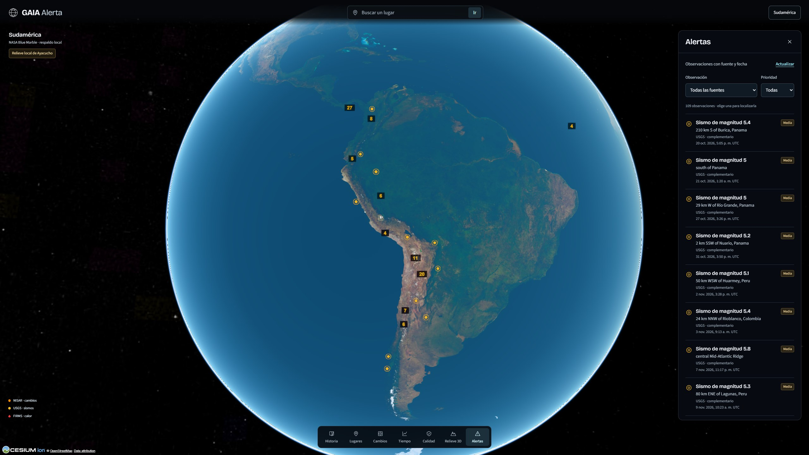

# GAIA Alerta

Detecta, mide y explica cambios de la superficie terrestre con **datos radar NISAR reales** (NASA-ISRO), sobre un **globo 3D**. Proyecto para el NASA Space Apps Challenge 2026, reto *Dancing with the SARs*.

## Arranque local

Instala las dependencias con `uv sync` y `npm --prefix apps/web ci`. Configura `EARTHDATA_TOKEN` y `FIRMS_MAP_KEY` en `.env` para acceder a los gránulos NISAR y los focos de calor. Configura `VITE_CESIUM_ION_TOKEN` en `apps/web/.env` antes de compilar para activar el relieve mundial.

```powershell
npm --prefix apps/web run build
uv run python scripts/run_demo.py
```

Abre [GAIA Alerta](http://127.0.0.1:8000/). Para la demo sin internet usa `uv run python scripts/run_demo.py --offline --port 8088`. La demo sirve el mapa NASA y el relieve local de Ayacucho junto con las últimas observaciones guardadas. Cada fuente muestra la fecha de su caché. Los archivos de datos bajo `data/` se conservan localmente.

## Caso Ayacucho

Busca «Huanta» para abrir el recorrido de Ayacucho. En Cambios o Calidad se puede consultar el catálogo ASF con las fechas, trayectorias y tamaños. Para generar la comparación se eligieron los GCOV del **19 de junio y 5 de octubre de 2026**, en la trayectoria 75 ascendente, marco 171. Las dos observaciones suman aproximadamente **3,86 GB**.

Con Earthdata configurado, `uv run python scripts/process_ayacucho.py` descarga los dos GCOV, registra sus capas HDF5 y publica las comparaciones HH y HV y sus series. La proyección de tendencia requiere cuatro fechas compatibles. El [registro de datos](docs/data-notes.md) documenta la selección, las fuentes territoriales y las comprobaciones pendientes.



[Ver el recorrido en Ayacucho](art/verificacion/gaia-alerta-ayacucho-2560.jpg) · [Video de respaldo](art/verificacion/gaia-alerta-demo.mp4)

## Cumplimiento del reto
Cada punto del enunciado oficial y dónde se cumple: `docs/06_Requisitos_del_Reto.md`.

## Licencia
MIT (código abierto, como pide el reto).
