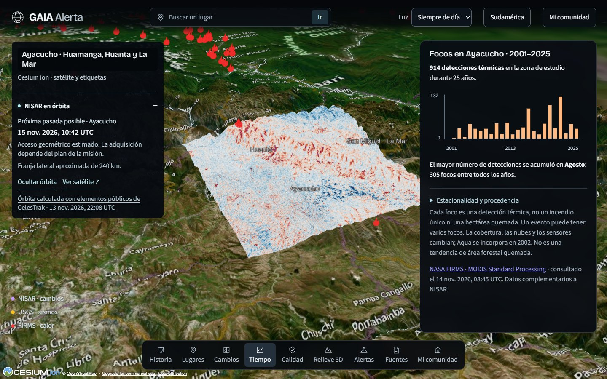
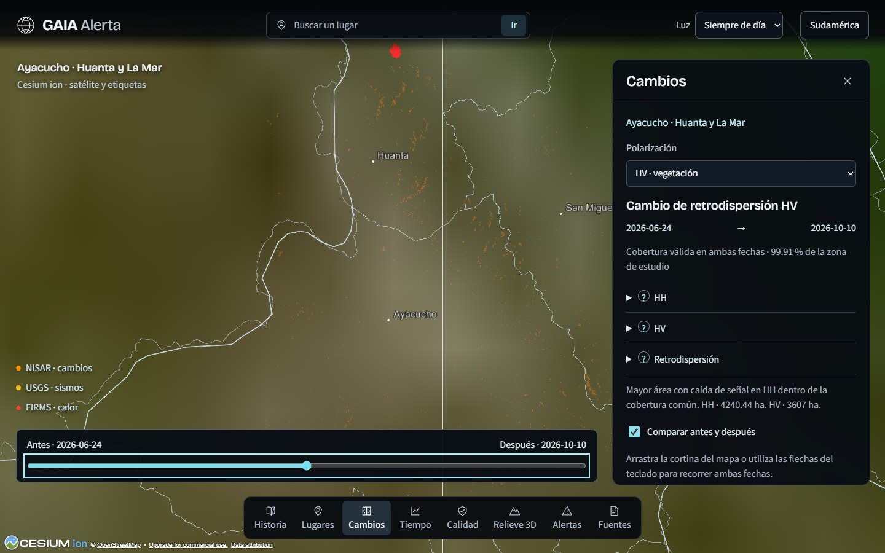

# GAIA Alerta

Detecta, mide y explica cambios de la superficie terrestre con **datos radar NISAR reales** (NASA-ISRO), sobre un **globo 3D**. Proyecto para el NASA Space Apps Challenge 2026, reto *Dancing with the SARs*.

## Arranque local

Instala las dependencias con `uv sync` y `npm --prefix apps/web ci`. Configura `EARTHDATA_TOKEN` y `FIRMS_MAP_KEY` en `.env` para acceder a los gránulos NISAR y los focos de calor. Configura `VITE_CESIUM_ION_TOKEN` en `apps/web/.env` antes de compilar para activar el relieve mundial.

```powershell
npm --prefix apps/web run build
uv run python scripts/run_demo.py
```

Abre [GAIA Alerta](http://127.0.0.1:8000/). Para la demo sin internet usa `uv run python scripts/run_demo.py --offline --port 8088`. La demo sirve el mapa NASA y el relieve local de Ayacucho junto con las últimas observaciones guardadas. Cada fuente muestra la fecha de su caché. Los archivos de datos bajo `data/` se conservan localmente.

## Caso Ayacucho

Busca «Huanta» para abrir el recorrido de Ayacucho. La comparación activa usa los GCOV del **24 de junio y 10 de octubre de 2026**, trayectoria 147 ascendente, marco 171, con HH/HV y la misma versión de procesamiento. Suman **4,16 GB**. La cobertura válida común es del **99,91 %** de la caja de estudio.

Con Earthdata configurado, ejecuta `uv run python tools/download_approved.py` y después `uv run python scripts/process_ayacucho.py`. La ingesta registra los originales con SHA-256. El procesamiento inspecciona HDF5, publica HH/HV y activa el período completo cuando supera el 80 % de cobertura válida. El período anterior se conserva en el archivo local. La proyección de tendencia requiere cuatro fechas compatibles.

HV presenta **3.607 ha con caída de señal**. Las **498 manchas delimitadas** reúnen **938,28 ha** y el resto son fragmentos inferiores al mínimo de 25 píxeles. OPERA del 13 de octubre coincide en **21,08 ha**, el **2,25 %** de esas manchas, con intersección/unión del **0,80 %**. La atribución a incendios continúa por verificar. Cada ficha muestra exposición con WorldPop, WorldCover y localidades OSM, con las fechas, licencias y disponibilidad de cada fuente. El [registro de datos](docs/data-notes.md) detalla el método y sus límites.

El globo abre con **Siempre de día**. El selector de la barra permite explorar la iluminación solar en **Hora real**.

## Comunidades, clima y agricultura

Mi comunidad reúne 3 provincias, 39 distritos y 1148 localidades de Ayacucho. Cada ficha muestra cultivos, pastizales, bosque y población estimada dentro de las manchas radar, con la cobertura de cada fuente. La selección activa la zona NISAR y vuela al lugar. El semáforo combina observaciones recientes de FIRMS, USGS y NASA POWER, con razones y umbrales visibles. Es informativo y enlaza las recomendaciones oficiales.

El cruce agrícola delimita **518,36 ha de cultivos con cambio HV**, de las cuales **58,046 ha** caen en pendientes de más de **15°**. Usa elevaciones Mapzen sobre una rejilla métrica de 30 m y WorldCover 2021, con ponderación por área. Estos datos no confirman suelo desnudo ni erosión. La comparación óptica **HLS S30 v2 del 22-jun y 8-oct de 2026** y las observaciones fenológicas de SENAMHI sirven para investigar la hipótesis agrícola. Los documentos de SENAMHI corresponden a otras localidades y campañas y se identifican como contexto.

Tiempo muestra 45 años completos de NASA POWER (1981–2025), observaciones recientes y una extrapolación estadística con incertidumbre. El archivo MODIS 2001–2025 reúne **914 detecciones** tras verificar las consultas de sus **9131 días**. Sus focos son detecciones térmicas, no incendios únicos ni hectáreas quemadas. Chosica cuenta con un acumulado IMERG Late real de **13,62 mm** en el episodio del 22–24 de febrero de 2026.

Los reportes ciudadanos se guardan como pendientes y requieren moderación con una clave del servidor. Las notas no se publican y la ubicación se aproxima para proteger a las personas. Las fichas se pueden compartir o imprimir.

Para reproducir los datos extra, consulta [el registro de la ampliación](docs/21_Datos_Extra_Verificados.md). La [revisión 19](docs/20_Cierre_Revision_19.md) documenta los ajustes de lluvia, comunidad y navegación.



[Cortina óptica HLS](art/verificacion/datos-extra/hls-1440.jpg) · [Ficha agrícola en teléfono](art/verificacion/datos-extra/pendiente-390.jpg)



[Ver exposición territorial](art/verificacion/final/exposicion-1440.jpg) · [Video de respaldo de 2 min 38 s](art/verificacion/gaia-alerta-demo.mp4)

## Cumplimiento del reto
Cada punto del enunciado oficial y dónde se cumple: `docs/06_Requisitos_del_Reto.md`.

## Despliegue

[Guía del contenedor con la API en vivo y los datos NISAR publicados](docs/15_Despliegue_Completo.md).

## Licencia
MIT (código abierto, como pide el reto).
